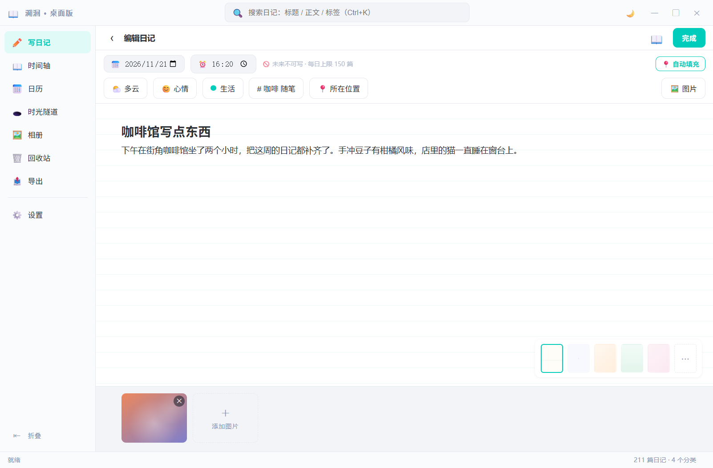
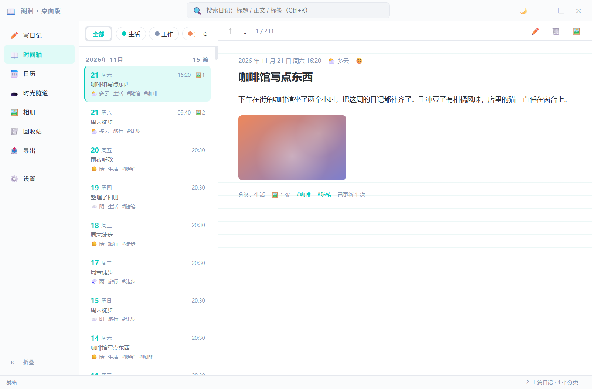
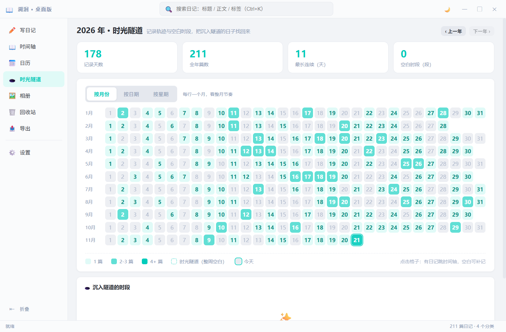
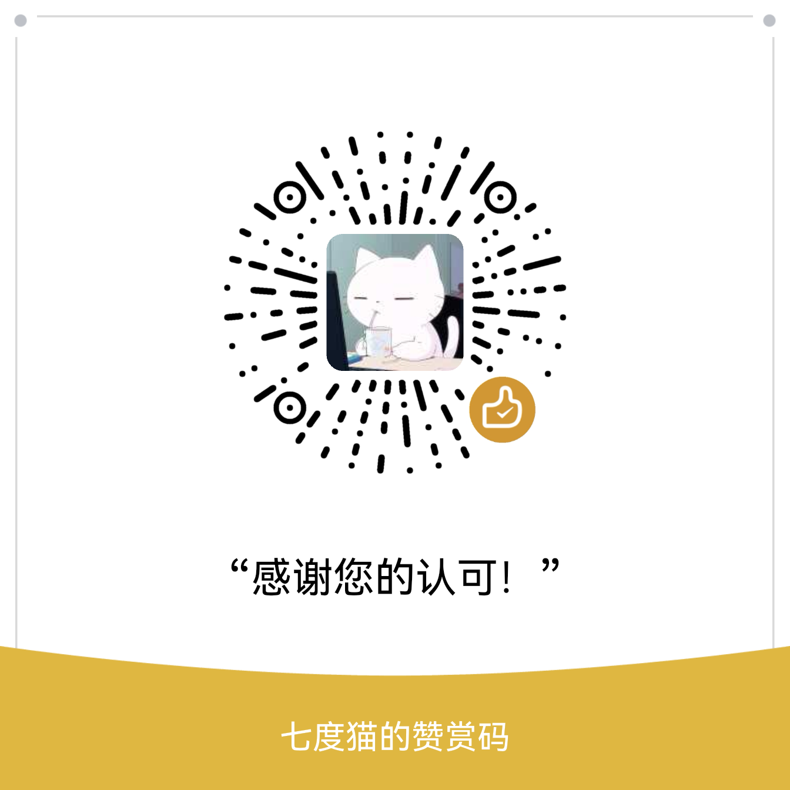

# Suhui Desktop (溯洄桌面版)

[简体中文](./README.md) | English

A privacy-first **local diary app**. All data stays on your own computer — no account, no cloud, no telemetry.

"Suhui" (溯洄) comes from a classical Chinese poem: "To trace the stream upward after it, the way is hard and long." Keeping a diary is exactly that — walking back up the river of time to recover the days that sank into the tunnel.

## Screenshots

<p align="center">
  
  
</p>
<p align="center">
  
</p>
<p align="center"><sub>All screenshots show programmatically generated sample data, not real diary entries.</sub></p>

> **Note**: This app is currently localized in Chinese only. The UI language is Simplified Chinese.

## Features

- **✏️ Write** — weather, mood, letter-paper styles, categories and tags, with keyboard shortcuts; lightweight and restrained
- **📖 Timeline** — browse all entries in reverse chronological order
- **📅 Calendar** — revisit each day on a monthly calendar
- **🕳️ Time Tunnel** — a yearly heatmap (by month / by day / by weekday) with stats: recorded days, longest streak, and blank periods
- **🖼️ Album** — browse every photo embedded in your entries in one place
- **🗑️ Trash Bin** — soft delete with one-click restore
- **📤 Import / Export** — merge-export to PDF / Word / HTML / long image, with date-range & category filters and an entry-by-entry preview before exporting; import from Markdown (with images, duplicates skipped)
- **💾 Auto Backup** — scheduled snapshots, on-exit backup, and retention policy; the backup manager supports one-click backup, list-and-restore, and cleanup, with the newest copy always protected
- **⌨️ Shortcuts** — Ctrl+N new entry, Ctrl+F search, Ctrl+E export, F1 cheat sheet; formatting inserts (lists, divider, timestamp) in the editor
- **🎨 Personalization** — 5 theme colors, 15 built-in letter papers + DIY paper customization, night mode
- **🧰 Management Pages** — categories / tags / papers, with drag-and-drop category ordering
- **🚀 Extras** — launch on system startup (installed build), follow system light/dark mode

## Data & Privacy

- Data is stored in a local SQLite database (better-sqlite3); nothing is ever uploaded
- No accounts, no analytics, no network requests
- Backups are also written to the local disk only

## Tech Stack

| Layer | Technology |
|---|---|
| Desktop shell | Electron 45 |
| Build | electron-vite · Vite |
| Frontend | Vue 3 · Pinia · Vue Router |
| Storage | better-sqlite3 (local SQLite) |
| Packaging | electron-builder (Windows NSIS) |

## Development

Requirements: Node.js ≥ 18, Windows 10/11.

```bash
# Install dependencies
npm install

# Start in dev mode (hot reload)
npm run dev

# Build renderer output
npm run build

# Package a Windows installer (output in release/)
npm run dist:win

# Interactive release script; version format {major}.{stage}.{yy}{iii}, e.g. 1.0.26101
npm run release
```

## Project Layout

```
suhui-desktop/
├── electron/          # Main process: window, SQLite DAO, migrations, backup, import/export
├── src/               # Renderer: Vue 3 views, components, Pinia stores
├── resources/         # App icon
└── scripts/           # Release & test scripts
```

## Support the Author

If Suhui Desktop helps you, feel free to buy the author a coffee ☕

<details>
<summary>📱 WeChat appreciation QR code (click to expand)</summary>

<p align="center">
  
</p>

</details>

## License

[MIT](./LICENSE)
