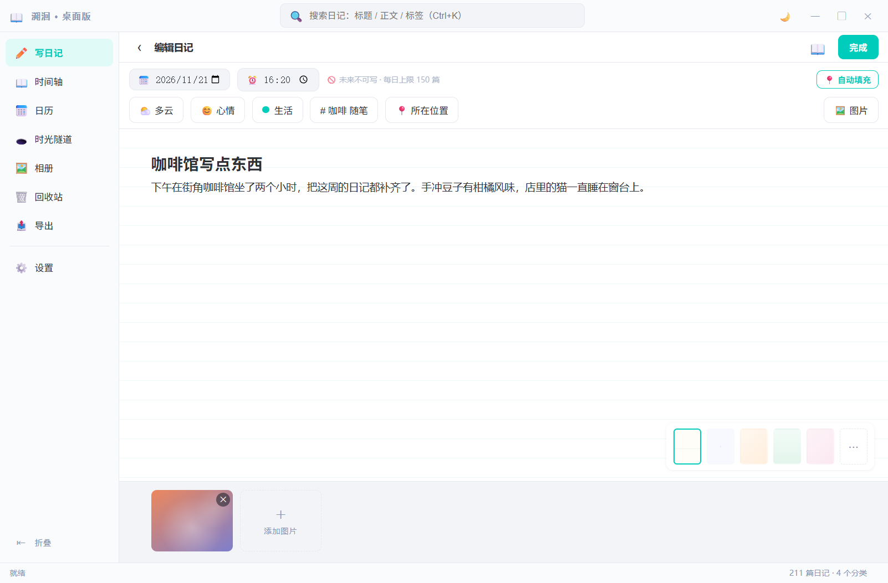
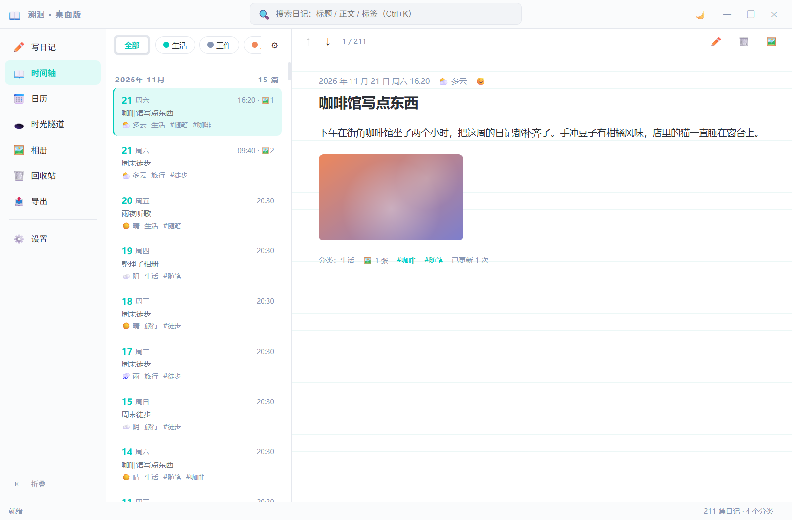
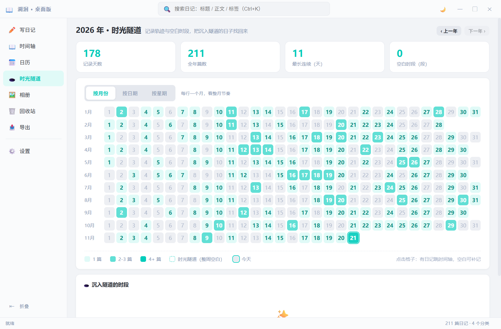

# 溯洄桌面版 (Suhui Desktop)

[English](./README.en.md) | 简体中文

一款注重隐私的**本地日记应用**。所有数据存储在你自己的电脑上——无账号、无云端、无遥测。

「溯洄」取自《诗经·蒹葭》："溯洄从之，道阻且长。"写日记，就是沿时间的河流往回走，把沉入隧道的日子找回来。

## 应用预览

<p align="center">
  
  
</p>
<p align="center">
  
</p>
<p align="center"><sub>截图均为程序生成的示例数据，非真实日记</sub></p>

## 功能特性

- **✏️ 写日记** — 天气、心情、信笺纸张与分类标签，快捷键加持，轻量而克制
- **📖 时间轴** — 按时间倒序翻阅所有日记
- **📅 日历** — 以月历形式回顾每天的记录
- **🕳️ 时光隧道** — 年度热力图（按月 / 按日期 / 按星期三种尺度），统计记录天数、最长连续、空白时段
- **🖼️ 相册** — 集中浏览散落在日记中的全部图片
- **🗑️ 回收站** — 软删除与一键恢复
- **📤 导入导出** — 合并导出 PDF / Word / HTML / 长图，导出前可按日期范围与分类筛选、逐条预览确认；从 Markdown 导入（含图片随迁、重复内容跳过）
- **💾 自动备份** — 定时快照、退出备份、保留策略；备份管理中心支持一键备份、列表恢复与清理，最新一份始终受保护
- **⌨️ 快捷键** — Ctrl+N 新建、Ctrl+F 搜索、Ctrl+E 导出、F1 速查；写作页提供列表 / 分隔线 / 时间戳等排版快捷插入
- **🎨 个性化** — 5 款主题色、15 款内置信笺 + 信纸 DIY 自定义、夜间模式
- **🧰 管理页** — 分类 / 标签 / 信笺管理，分类支持拖拽排序
- **🚀 其他** — 开机自启（安装版生效）、随系统深浅色切换

## 数据与隐私

- 数据保存在本地 SQLite 数据库（better-sqlite3），不上传任何服务器
- 无账号体系、无统计埋点、无网络请求
- 备份文件同样只落本地磁盘

## 技术栈

| 层 | 技术 |
|---|---|
| 桌面壳 | Electron 45 |
| 构建 | electron-vite · Vite |
| 前端 | Vue 3 · Pinia · Vue Router |
| 存储 | better-sqlite3（本地 SQLite） |
| 打包 | electron-builder（Windows NSIS） |

## 本地开发

环境要求：Node.js ≥ 18，Windows 10/11。

```bash
# 安装依赖
npm install

# 开发模式（热更新）
npm run dev

# 构建渲染产物
npm run build

# 打包 Windows 安装包（release/ 目录）
npm run dist:win

# 交互式发布：版本号规则 {大版本}.{阶段}.{年份2位}{迭代3位}，如 1.0.26101
npm run release
```

## 目录结构

```
suhui-desktop/
├── electron/          # 主进程：窗口、数据库 DAO、迁移、备份、导入导出
├── src/               # 渲染进程：Vue 3 视图、组件、Pinia stores
├── resources/         # 应用图标
└── scripts/           # 发布与测试脚本
```

## 许可证

[MIT](./LICENSE)
